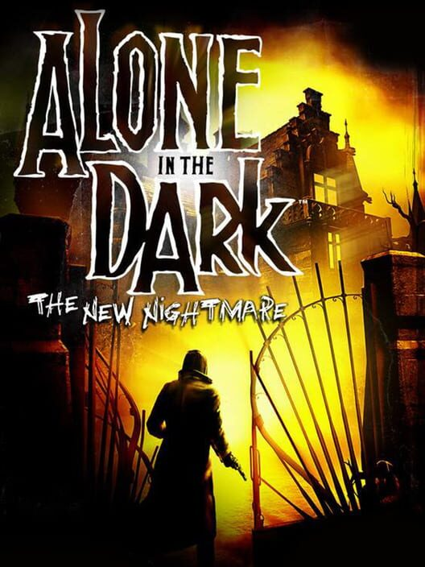

# silent-hill-shattered-memories-wii-alone-in-the-dark-the-new-nightmare
## Silent Hill Shattered Memories Wii - Alone in the Dark The New Nightmare Remake
A remake of Alone in the Dark: The New Nightmare (2001), rebuilt in the Silent Hill: Shattered Memories engine, using its motion controls, pointer aiming, and Wii survival horror mechanics as the technical base.

## Github Treeview
[https://treegit.macosxjs.com/?url=igiteam/silent-hill-shattered-memories-wii-alone-in-the-dark-the-new-nightmare](https://treegit.macosxjs.com/?url=igiteam/silent-hill-shattered-memories-wii-alone-in-the-dark-the-new-nightmare)

## Github Tree Api Direct JSON
[https://api.github.com/repos/igiteam/silent-hill-shattered-memories-wii-alone-in-the-dark-the-new-nightmare/git/trees/main?recursive=1](https://api.github.com/repos/igiteam/silent-hill-shattered-memories-wii-alone-in-the-dark-the-new-nightmare/git/trees/main?recursive=1)

## Base Gameplay
[](https://ytembed.macosxjs.com/?V05OWFFxQnRMVFk)

[](https://ytembed.macosxjs.com/?SzVTdnBuR05tMTA)

## WS11WineCX20.0.4 (macOS Big Sur 32-bit)

[WS11WineCX20.0.4.tar.7z](https://github.com/vitor251093/porting-kit-engines/releases/download/wineskin/WS11WineCX20.0.4.tar.7z)

[](https://github.com/igiteam/wine_engines)


## Reference Links
[https://github.com/dolphin-emu/dolphin](https://github.com/dolphin-emu/dolphin)

[https://dolphin-emu.org/](https://dolphin-emu.org/)

[https://archive.org/details/alone4cds](https://archive.org/details/alone4cds)

[https://vimm.net/vault/63759](https://vimm.net/vault/63759)

[](https://archive.org/details/alone4cds)

[](https://vimm.net/vault/63759)


---

# Alone in the Dark: The New Nightmare – Classic Reborn

Play **Alone in the Dark: The New Nightmare** (2001) on modern PCs, with its original prerendered backgrounds, videos, music and scripts, and a set of careful fixes and options.

Classic Reborn is a **new engine written from scratch in C++17**: nothing of the original executable is used or copied; the engine reads the game's own files and does what the original does with them. It is the newest member of the *Classic Reborn* family, after [Alone in the Dark: Classic Reborn](https://github.com/nayo186/AloneInTheDarkClassicReborn) (the 1992-1995 trilogy) and [Time Gate: Classic Reborn](https://github.com/nayo186/TimeGateClassicReborn).

> **The game data is not included.** You need your own copy of *Alone in the Dark: The New Nightmare* for PC (the GOG edition or the CD). Nothing of the original game is in this repository, and the engine never writes into the game's folder.

> **The engine is in development: there is no download yet.** It can be built from the source (see [Building](#building)). The first version for players will come with its own launcher, like the other Classic Reborn projects.

## How it was made

The New Nightmare runs on Darkworks' own engine: 3D characters over prerendered backgrounds, with a real-time flashlight that lights the scene. No open source engine for it existed, so this one was built from the beginning:

- **The file formats** (levels, backgrounds, models, animations, sounds, music, menus, voices) were studied one by one, and the engine reads them as the game does. The tools in `tools/` read and export them too.
- **The game's behaviour** was studied in the original PC executable with Ghidra, function by function, and rewritten as new, readable C++: the hero's controls, collisions, cameras, monsters, weapons, particles, lights. The addresses and what each function does are written down in `docs/`.
- **The game's logic** (doors, items, events, the radio talks) is not in the executable: it lives in the scripts of each level, which the engine runs as the original did.
- **Everything else** (drawing with Direct3D 11, Direct3D 12 or Vulkan, sound, videos, menus) is new code.

## What works today

- The game's videos (logos, intro, the heroes' videos), the title screen and the choice of Carnby or Aline.
- The levels: the prerendered backgrounds with their foreground, the cameras changing as in the game, the walls and floors, the game's scripts.
- Carnby and Aline with the game's controls: walk, run, turn, walk back, half turn, aim and shoot.
- The flashlight lighting the scene, its flare, the hand light and the characters' shadow.
- The radio talks with their voices, the inventory, the monsters, the music and the sounds, the rain and the lightning.
- Quick save and load.

Much is still missing before the game can be played from start to end. If something behaves differently from the original, please [report it](#reporting-a-problem).

## Requirements

- **Windows** 10 or 11, 64-bit, with a graphics card that supports Direct3D 11 (or Direct3D 12 or Vulkan).
- Your own copy of *Alone in the Dark: The New Nightmare* for PC.

## Running

```
NewNightmare.exe --data "<folder of the game>" [--renderer d3d11|d3d12|vulkan] [--level N --camera N]
```

`--level N` starts directly in that level, without the videos and the title.

## Controls

The game's own keys (`keys.bin`, the ones chosen in the original):

| Action | Default key |
|---|---|
| Walk, turn | Arrows (Down twice quickly: half turn) |
| Run | A |
| Use, shoot, answer | Space (Enter also confirms) |
| Flashlight on and off | S |
| Aim (with a weapon in hand) | Left Ctrl |
| Inventory | I |
| Move the flashlight while standing still | Left Shift + arrows, or the left mouse button |
| Skip a video, back to the title | Esc |
| Quick save, quick load | F5, F8 |
| Direct3D 11 → Direct3D 12 → Vulkan | F2 |

## Folders

Everything the engine writes (today, the saved game) goes to a `UserData` folder next to the executable. The game's folder is only read.

## Reporting a problem

Found a bug? Please open an [issue](https://github.com/nayo186/TheNewNightmareClassicReborn/issues) and tell us:

- what happened and what you were doing (in which place of the game, if you can);
- with which hero: Carnby or Aline;
- where your copy comes from (GOG or the CD) and its language;
- your Windows version and graphics card.

A screenshot or a short video of the problem helps a lot.

## Building

You need Visual Studio 2022 or 2026 (Desktop development with C++), CMake 3.21 or newer and Python 3.

1. Download FFmpeg (LGPL, used to play the game's Bink videos) into `ThirdParty/ffmpeg`:
   ```
   python tools/getFFmpeg.py
   ```
2. Generate the solution, giving the folder of your copy of the game:
   ```
   cmake -G "Visual Studio 18 2026" -A x64 -S . -B build\vs2026 "-DNEWNIGHTMARE_DATA=C:/Games/Alone in the Dark - The New Nightmare"
   ```
   With Visual Studio 2022: `-G "Visual Studio 17 2022"` and `-B build\vs2022`.
3. Open `build\vs2026\NewNightmare.slnx`, choose **RelWithDebInfo x64** and start `NewNightmare` (F5).

The program is built into `build\vs2026\bin\RelWithDebInfo\`, with the FFmpeg DLLs next to it. The C++ runtime is inside the executable: it needs nothing else installed.

The Python tools find the game in the folder given with `--data`, in the `NEWNIGHTMARE_DATA` environment variable, or in a folder `aitd4-data` next to the repository. The Ghidra scripts (`tools/ghidra/run.ps1`) use `GHIDRA_INSTALL_DIR`.

## Architecture

```
src/
  util/       support with no game knowledge (reading, unpacking and unscrambling the data files)
  platform/   window (SDL3), sound mixer, videos (FFmpeg), drawing (bgfx) and its shaders
  core/       the game's formats and logic: backgrounds, scenes, models, animations, the hero, monsters,
              weapons, inventory, music, sound banks, collisions, triggers, voices, particles, flashlight
  scripts/    the game's script language: its machine, the functions of the levels, the radio scenes
  app/        start and main loop, menus, saved games, music player
tools/        Python tools to read and export the game's files; Ghidra scripts
docs/         what is known of the executable and of the file formats, bugs fixed, lessons learned (in Spanish)
ThirdParty/   bgfx, SDL3 and zlib (FFmpeg is downloaded, see Building)
```

A layer never uses the ones above it: `util` → `platform` → `core` and `scripts` → `app`.

## Credits

- **Alone in the Dark: The New Nightmare** was created by Darkworks and published by Infogrames. This project contains none of its data and is not affiliated with its rights holders.
- Libraries: [bgfx](https://github.com/bkaradzic/bgfx) and [bgfx.cmake](https://github.com/bkaradzic/bgfx.cmake) (BSD 2-Clause), [SDL3](https://github.com/libsdl-org/SDL) (zlib license), [zlib](https://zlib.net) (zlib license) and [FFmpeg](https://ffmpeg.org) (LGPL 2.1, as DLLs, builds by [BtbN](https://github.com/BtbN/FFmpeg-Builds)). Each keeps its own license in its folder.

## Thanks

To everyone who played and tested the earlier Classic Reborn projects, reported problems and supported them: this one exists thanks to you.


## License

GNU General Public License v3: see [LICENSE](LICENSE). The libraries in `ThirdParty` keep their own licenses.


## Dev Environment

**Official White Wii Remote With Nunchuk — Tested And Working — £14.99**
[https://www.ebay.co.uk/itm/800847189353](https://www.ebay.co.uk/itm/800847189353)

**Infrared Sensor Bar USB for Wii Emulator Remote Motion Detection Setup — £6.69**
[https://www.ebay.co.uk/itm/227423830875](https://www.ebay.co.uk/itm/227423830875)

**Apple MacBook Pro Retina 15in (2014) i7 2.8GHz 16GB 1TB SSD GT 750M — £120.30**
[https://www.ebay.co.uk/itm/800844561513](https://www.ebay.co.uk/itm/800844561513)

**WS11WineCX20.0.4 (Wine engine)**
[https://igiteam.github.io/wine_engines/](https://igiteam.github.io/wine_engines/)

**Official Genuine Sony PS3 PlayStation 3 DualShock 3 Wireless Controller Black — £19.99**
[https://www.ebay.co.uk/itm/840031043465](https://www.ebay.co.uk/itm/840031043465)

**Amazon Basics 4K HDMI Cable 3m — 18Gbps High Speed with Ethernet, 4K@60Hz, 2160p — £8.44**
[https://www.ebay.co.uk/itm/327352257557](https://www.ebay.co.uk/itm/327352257557)

**wiimote_nunchuk_macosx**
[https://github.com/igiteam/wiimote-nunchuk](https://github.com/igiteam/wiimote-nunchuk)

**xbox360_input_gui_py**
[https://github.com/igiteam/xbox360_input_gui_py](https://github.com/igiteam/xbox360_input_gui_py)

**logitec_mx_mouse_3_macos**
[https://github.com/igiteam/logitec_mx_mouse_3_macos](https://github.com/igiteam/logitec_mx_mouse_3_macos)

**igi1-macbook-3d-workstation**
[https://github.com/igiteam/igi1-macbook-3d-workstation](https://github.com/igiteam/igi1-macbook-3d-workstation)

---
